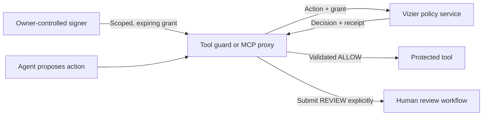

<!-- mcp-name: io.github.vassiliylakhonin/vizier-guard -->

# Vizier

Scoped authorization for AI agents before they act.

[](https://github.com/vassiliylakhonin/vizier/actions/workflows/ci.yml)
[](https://github.com/vassiliylakhonin/vizier/actions/workflows/deploy.yml)
[](https://github.com/vassiliylakhonin/vizier/releases)
[](LICENSE)

Vizier checks a proposed agent action against permissions signed by its owner and returns `ALLOW`, `BLOCK`, or `REVIEW` together with policy results and a receipt bound to the request.

Use it at the action boundary of an agent or recurring workflow: before a deployment, repository write, database change, message, or payment API call. A continuously running agent can receive short-lived permissions for specific actions and targets while the owner keeps control of the signing key.

[Playground](https://vizier.agendamcp.dpdns.org/playground) ·
[Live API reference](https://vizier.agendamcp.dpdns.org/docs) ·
[OpenAPI](https://vizier.agendamcp.dpdns.org/openapi.json) ·
[Quickstart](docs/AUTHORIZATION_QUICKSTART.md) ·
[Delegation setup](docs/DELEGATION_GRANTS.md) ·
[Threat model](docs/THREAT_MODEL.md)

## Why this matters

AI agents can act quickly, but not every action should be allowed just because the model or workflow requested it. Vizier adds a deterministic authorization layer between an agent's intent and the protected tool call.

This is useful when you need to enforce:

- owner-controlled permissions for agent actions
- short-lived delegated authority
- exact target scoping and action constraints
- review-before-execution for sensitive operations
- auditable receipts for action decisions

## What this project does

Vizier provides a policy and authorization service for agent actions.

It can validate:

- whether an action is allowed for a specific agent and principal
- whether the grant is signed by an owner
- whether the action matches the grant scope and constraints
- whether the request should be blocked, allowed, or escalated to human review

It does not decide whether the action is factually correct or ethically acceptable. It decides whether the action is authorized according to the signed authority model and policy rules.

## Quick start

### 1) Install the SDK

Node.js 24+ is required for the TypeScript SDK and deployment adapter.

```sh
npm install @agenda-intelligence/vizier-sdk@0.5.16
```

### 2) Verify an action with a signed delegation

```ts
import { readFile } from "node:fs/promises";
import { Vizier } from "@agenda-intelligence/vizier-sdk";

const client = new Vizier({
  baseUrl: "https://vizier.agendamcp.dpdns.org",
  apiKey: process.env.VIZIER_API_KEY,
});

const grantPath = process.env.VIZIER_GRANT_FILE;
if (!grantPath) throw new Error("An owner-issued grant file is required.");
const grant = (await readFile(grantPath, "utf8")).trim();

const result = await client.verify({
  agent: { id: "release-agent", owner: "platform-owner" },
  principal: { id: "platform-owner" },
  action: {
    type: "deploy_worker",
    target: "worker:example-worker",
    parameters: { commit: "reviewed-commit" },
  },
  authority: {
    allowed_actions: ["deploy_worker"],
    constraints: {
      allowed_targets: ["worker:example-worker"],
      allowed_sensitive_actions: ["deploy_worker"],
    },
  },
  context: { request_id: null, timestamp: null, source: "rest" },
  grant,
});

if (result.decision !== "ALLOW") {
  throw new Error(`Authorization failed: ${result.decision}`);
}

console.log("Authorized request:", result.receipt.id);
```

### 3) Gate the protected tool call

The service authorizes the action. Your integration still enforces the outcome before calling the protected tool.

## How it works



1. The owner signs an ES256 delegation: principal, agent, permitted actions, constraints, and expiry.
2. The integration submits the intended action and grant to `/v1/verify`.
3. Vizier verifies the signature, identities, expiry, and exact authority binding, then applies deterministic policies.
4. The guard validates the response and request binding before invoking the tool.

Important: an API key authenticates the caller; a delegation grant proves the owner's permission. They are separate roles.

## Important boundaries

- Vizier is an authorization service, not a fact checker.
- It does not prove that a tool executed successfully.
- It does not establish factual truth, legal clearance, payment settlement, or customer demand.
- A receipt records authorization, not a guarantee of a successful side effect.
- Self-hosted optional mode permits caller-asserted authority; receipts do not establish owner delegation.

## Choose your integration

| Your task | Start here | Prerequisites |
| --- | --- | --- |
| Try the deployment adapter locally | [Synthetic preparation example](#control-an-agents-infrastructure-deployment) | Node 24+; no keys for the preparation step |
| Verify an action with signed delegation | [SDK setup](#start-with-signed-delegation) | An operator API key, registered public key and owner-issued grant |
| Protect existing MCP tools | [Private MCP proxy](packages/mcp-proxy/README.md) | Operator-owned upstream credentials and a restricted tool route |
| Inspect the hosted API | [API reference](https://vizier.agendamcp.dpdns.org/docs) | Public documentation; execution permissions are separate |

## Control an agent's infrastructure deployment

For platform and security teams operating a DevOps agent: pin one existing Cloudflare Worker and require owner-signed scope plus human approval of the exact uploaded version before changing its traffic. Changed versions, out-of-scope targets, expired permissions, and repeated approval claims stop before execution.

Install the v0.5.16 SDK and deployment adapter from npm:

```sh
npm install @agenda-intelligence/vizier-sdk@0.5.16 @agenda-intelligence/vizier-gated-deploy@0.5.16
npx --no-install vizier-worker-deploy prepare \
  --scope node_modules/@agenda-intelligence/vizier-gated-deploy/examples/scope.json \
  --plan node_modules/@agenda-intelligence/vizier-gated-deploy/examples/plan.json
```

Preparation is local, uses synthetic IDs, and needs no keys. Follow the [integration and recovery guide](docs/WORKER_DEPLOY_PILOT.md) before submitting a real review or executing anything.

## Start with signed delegation

Experimental. The runnable examples pin published npm clients at v0.5.16.

```sh
npm install @agenda-intelligence/vizier-sdk@0.5.16
```

First [register a principal public key and mint a grant](docs/DELEGATION_GRANTS.md#setting-it-up) from an owner-controlled signer. This example requires a grant for `platform-owner` → `release-agent` with exactly this authority:

```json
{
  "allowed_actions": ["deploy_worker"],
  "constraints": {
    "allowed_targets": ["worker:example-worker"],
    "allowed_sensitive_actions": ["deploy_worker"]
  }
}
```

Keep the private signing key outside the action-taking agent. Supply the integration API key and a current grant file to the trusted guard.

## Connect through MCP

For a client with Streamable HTTP support, use:

```text
https://vizier.agendamcp.dpdns.org/mcp
```

The hosted service exposes a tool catalog and verification endpoint. Discovery requires no API key. Read the tool schema and metadata before constructing a request.

For a copyable Node 24 connection with no dependencies, run one explicit read-only profile from this checkout:

```sh
node examples/mcp-connect.ts --profile session
node examples/mcp-connect.ts --profile stateless
```

For a stdio-only client, this pinned transport adapter connects to the same hosted tool:

```json
{
  "mcpServers": {
    "vizier": {
      "command": "npx",
      "args": [
        "-y", "mcp-remote@0.15.1",
        "https://vizier.agendamcp.dpdns.org/mcp",
        "--transport", "http-only"
      ]
    }
  }
}
```

This configuration sends calls to the hosted service and is anonymous: verification can return `BLOCK` or `REVIEW`, never `ALLOW`.

## Interfaces and capabilities

| Surface | Role |
| --- | --- |
| REST `/v1/verify` | Action checks with deterministic policies, delegation provenance and request-bound receipts |
| TypeScript SDK | Validates response contracts and bindings; includes explicit human-review helpers |
| [Python SDK](packages/python-sdk) | Standard-library client, function guards and framework adapters |
| MCP service | Discover and call verification tools |
| MCP enforcement proxy | Intercepts configured tool calls, validates authorization, and forwards permitted calls |
| A2A | Verification adapter and agent card discovery |
| Human review queue | Separate reviewer credential, signed approval tokens and atomic server claims |

## Working integrations

The Agenda fleet uses Vizier in an owner-operated deployment workflow. This is concrete operational use by the same maintainer; it is not external customer adoption.

| Workflow | Protected action | Evidence |
| --- | --- | --- |
| Agenda Worker fleet | Target-scoped `deploy_worker` authorization before deployment | [Public workflow](https://github.com/vassiliylakhonin/agenda-intelligence-md/blob/main/.github/workflows/deploy.yml) |

The workflow separates signer and execution steps and supplies short-lived owner-signed grants. Missing or expired grants and invalid required receipts stop that deployment path.

## Receipts and trust boundary

A `/v1/verify` receipt records the request hash, decision, rule results, and authority provenance. The legacy verification receipt itself is unsigned; the grant behind a `principal_signed` decision is owner-signed. The SDK checks response consistency and recomputes the request hash over canonical JSON.

Visualization of the trust boundary:

- the integration enforces the decision
- the agent or operator with direct tool credentials can bypass that integration
- short-lived grants are not single-use execution reservations
- authorization does not replace human judgment or operational controls

## Development

Node.js 24+ is required for the Worker and TypeScript packages.

```sh
npm ci
npm run check
```

`check` runs package builds, type checks, migration checks, lint, tests, and a Worker deployment dry run. It does not publish or deploy.

Useful references:

- [Architecture](docs/ARCHITECTURE.md)
- [Claims](docs/CLAIMS.md)
- [Security review](docs/SECURITY_REVIEW.md)
- [Pilot scope](docs/PILOT.md)
- [Issues and integration feedback](https://github.com/vassiliylakhonin/vizier/issues)

## License

[MIT License](LICENSE).
