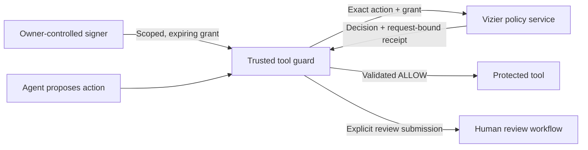

<!-- mcp-name: io.github.vassiliylakhonin/vizier-guard -->

# Vizier

**Authorize AI agent actions before tools execute.**

[](https://www.npmjs.com/package/@agenda-intelligence/vizier-sdk)
[](https://github.com/vassiliylakhonin/vizier/actions/workflows/ci.yml)
[](https://github.com/vassiliylakhonin/vizier/releases)
[](LICENSE)

Vizier checks proposed tool calls against **owner-signed, scoped, expiring permissions** and deterministic policies. It returns `ALLOW`, `BLOCK`, or `REVIEW`, with rule results and a receipt bound to the request. Your trusted guard enforces the result before a deployment, repository write, database change, message, or payment API call.

Use the TypeScript or Python client, protect existing tools with the MCP proxy, or integrate through REST and A2A. **No LLM is involved in the authorization decision.**

[Try the playground](https://vizier.agendamcp.dpdns.org/playground) · [Quick start](#quick-start) · [SDK example](#start-with-signed-delegation) · [MCP](#connect-through-mcp) · [API reference](https://vizier.agendamcp.dpdns.org/docs) · [Threat model](docs/THREAT_MODEL.md)

## What can you control?

| Workflow | What the integration can enforce | Start here |
| --- | --- | --- |
| Agent tool calls | Permitted actions, exact targets, constraints, and grant expiry | [Signed delegation](#start-with-signed-delegation) |
| Existing MCP tools | Allowed tools and upstream routes, checked before forwarding | [MCP enforcement proxy](packages/mcp-proxy/README.md) |
| Cloudflare Worker deployments | One existing Worker and human approval of the exact uploaded version | [Local preparation demo](#quick-start) |
| Sensitive operations | An explicit human-review step bound to the proposed action | [Review helpers](packages/sdk/README.md#explicit-human-reviews) |

**An API key identifies the integration. A signed grant carries the owner's permission.** Keep the private signing key and protected tool credentials outside the agent's control.

## Quick start

Try [the browser playground](https://vizier.agendamcp.dpdns.org/playground), or run the
[reproducible first-BLOCK walkthrough](docs/FIRST_BLOCK.md). It starts a disposable
local Worker, sends the same request through the TypeScript and Python clients,
and proves that both clients reject a tampered receipt. No account, production
API key, Cloudflare account, deployment, or payment is needed.

From a source checkout, with Node.js 24+ and Python 3.9+:

```sh
npm ci
python3 -m venv .venv
.venv/bin/python -m pip install -e 'packages/python-sdk[receipts]'
VIZIER_DEMO_PYTHON="$PWD/.venv/bin/python" npm run demo:first-block -- --signed
```

Expected: `BLOCK (GRANT_REQUIRED)` in both languages, verified request hashes and
ES256 signatures, followed by rejection of tampered receipts. This checks current
source. The [published-package path](docs/FIRST_BLOCK.md#published-clients) runs
the same signed checks against the released clients, npm `0.5.17` and PyPI
`vizier-guard 0.3.3`.

### Optional: prepare a deployment review

To prepare a deployment review locally with **Node.js 24+**:

```sh
mkdir vizier-demo
cd vizier-demo
npm install @agenda-intelligence/vizier-sdk@0.5.17 @agenda-intelligence/vizier-gated-deploy@0.5.17
npx --no-install vizier-worker-deploy prepare \
  --scope node_modules/@agenda-intelligence/vizier-gated-deploy/examples/scope.json \
  --plan node_modules/@agenda-intelligence/vizier-gated-deploy/examples/plan.json
```

**No API key or Cloudflare account is needed for `prepare`.** After installation, this step runs locally without network calls. The bundled scope and plan use synthetic IDs.

You get JSON containing:

- `review`: the exact Worker version and traffic percentage to review;
- `review_hash`: a SHA-256 hash binding that review to its contents;
- `authority`: the action and target scope the owner would need to sign.

This prepares a review; it does not authorize or deploy anything. For a real sandbox, follow the [operator setup and recovery guide](docs/WORKER_DEPLOY_PILOT.md). The adapter's `submit` and `execute` modes require additional credentials; execution requires both a matching signed grant and approval of the exact review.

For general policy exploration, use the [local REST scenarios](docs/AUTHORIZATION_QUICKSTART.md#try-three-local-examples). Anonymous evaluation can return `BLOCK` or `REVIEW`, never `ALLOW`.

## How it works



1. The owner signs an ES256 delegation for a principal, agent, permitted actions, constraints, and expiry.
2. The guard submits the intended action and grant to `/v1/verify`.
3. Vizier checks the signature, identities, expiry, exact authority binding, and deterministic policies.
4. The guard validates the response and request binding before invoking the protected tool.

| Decision | What the caller should do |
| --- | --- |
| `ALLOW` | Proceed only through the trusted executor, with the exact authorized action and required execution controls. |
| `BLOCK` | Stop. Inspect `reason_codes` and `policy_results`; fix the underlying request or permissions. |
| `REVIEW` | Stop execution. Submit a separate human review explicitly if the integration supports it. |

A verification response does not execute the action or automatically open a review.

## Start with signed delegation

**Prerequisites:** an operator-issued API key, a registered principal public key, and a matching owner-issued grant. Follow [delegation setup](docs/DELEGATION_GRANTS.md#setting-it-up) first. An API key alone is insufficient in required-grant mode.

Install the TypeScript client (Node.js 24+):

```sh
npm install @agenda-intelligence/vizier-sdk@0.5.17
```

Supply `VIZIER_API_KEY` and `VIZIER_GRANT_FILE` to the trusted guard. For this example, the grant must bind `platform-owner` to `release-agent` and contain **exactly the `authority` object below**. Keep the private signer separate.

Save as `authorize.mjs`:

```ts
import { readFile } from "node:fs/promises";
import { Vizier } from "@agenda-intelligence/vizier-sdk";

const apiKey = process.env.VIZIER_API_KEY;
const grantPath = process.env.VIZIER_GRANT_FILE;
if (!apiKey || !grantPath) {
  throw new Error("Set VIZIER_API_KEY and VIZIER_GRANT_FILE in the trusted guard.");
}

const vizier = new Vizier({
  baseUrl: "https://vizier.agendamcp.dpdns.org",
  apiKey,
});
const grant = (await readFile(grantPath, "utf8")).trim();

const result = await vizier.authorize({
  agent: { id: "release-agent", owner: "platform-owner" },
  principal: { id: "platform-owner" },
  action: {
    type: "deploy_worker",
    target: "worker:example-worker",
    parameters: { commit: "reviewed-commit" },
  },
  authority: {
    allowed_actions: ["deploy_worker"],
    constraints: {
      allowed_targets: ["worker:example-worker"],
      allowed_sensitive_actions: ["deploy_worker"],
    },
  },
  context: { request_id: null, timestamp: null, source: "rest" },
  grant,
});

// authorize() throws unless the response establishes a request-bound ALLOW
// with matching, unexpired principal-signed delegation.
console.log("Authorized request:", result.receipt.id);
```

Run `node authorize.mjs` after configuring those prerequisites. A valid authorization prints a receipt ID; a refusal throws. This example performs only the authorization request. Use the [deployment adapter](packages/gated-deploy/README.md) for the separate, version-specific execution workflow.

`authorize()` validates the response contract, recomputes the request hash, and rejects `BLOCK`, `REVIEW`, expired grants, and mismatched delegation. It relies on the configured trusted service and HTTPS: the unsigned `receipt` object is not itself a signature. When the Worker has a receipt signing key and the request sends `X-Vizier-Receipt: jws`, enforcement responses also carry `receipt_jws` (ES256, verifiable against `/.well-known/jwks.json`). The published clients, npm `0.5.17` and PyPI `vizier-guard 0.3.3`, verify it against the JWKS when present; absence is tolerated by default, and the TypeScript SDK's opt-in `requireReceiptJws` makes a missing JWS an error. See the [versioned walkthrough](docs/FIRST_BLOCK.md). Execution, request immutability, idempotency, and replay controls remain the integration's responsibility.

## Connect through MCP

### Call the hosted verification service

For a Streamable HTTP MCP client:

```text
https://vizier.agendamcp.dpdns.org/mcp
```

Discovery needs no API key. Read the discovered tool schema and metadata before constructing a request. Anonymous verification is evaluation-only and cannot return `ALLOW`.

From a source checkout, inspect either supported connection profile with Node 24+ and no extra dependencies:

```sh
node examples/mcp-connect.ts --profile session
node examples/mcp-connect.ts --profile stateless
```

These commands perform read-only discovery. A rejected connection includes correction guidance; fix the request and explicitly retry the selected profile.

<details>
<summary>Configuration for a stdio-only MCP client</summary>

This pinned transport adapter connects to the hosted verification service anonymously:

```json
{
  "mcpServers": {
    "vizier": {
      "command": "npx",
      "args": [
        "-y", "mcp-remote@0.15.1",
        "https://vizier.agendamcp.dpdns.org/mcp",
        "--transport", "http-only"
      ]
    }
  }
}
```

It exposes evaluation, not permission to execute: anonymous calls can return `BLOCK` or `REVIEW`, never `ALLOW`.

</details>

### Enforce authorization on your own MCP tools

The [private MCP enforcement proxy](packages/mcp-proxy/README.md) sits between the agent and a supported HTTP MCP server. It filters tool discovery and checks configured calls before forwarding them. Configure the signed grant, allowed tools, upstream identity, and protected credentials using the [proxy setup guide](docs/DELEGATION_GRANTS.md#protected-mcp-proxy).

The hosted verification service does not intercept your other tools automatically. Remove the agent's direct upstream access so it cannot bypass the proxy.

## Trust boundaries

- **Authorization scope:** Vizier checks permissions and policy rules. It does not establish factual truth, legal clearance, payment settlement, or successful tool execution.
- **Receipts:** `/v1/verify` receipts bind a decision to a request hash. The `receipt` object is unsigned; when a receipt signing key is configured and the caller sends `X-Vizier-Receipt: jws`, enforcement responses (not anonymous evaluation) add `receipt_jws`, a compact ES256 JWS over that exact receipt, verifiable with the published JWKS. The delegation grant is owner-signed. [Action Covenants](docs/ADR-0001-ACTION-COVENANTS.md) have separate signed formats and compatibility limits.
- **Execution:** a guard protects only the path it controls. An agent or operator with direct tool credentials can bypass it. Grants are reusable until they expire unless the principal signs `single_use: true`; a single-use grant is spent at `ALLOW`, not when the action succeeds, enforcement of one fails closed (`BLOCK`) without the D1 binding, and revocation is operator-driven (see [delegation grants](docs/DELEGATION_GRANTS.md)).
- **Deployment review:** claiming an approval and performing a cloud deployment are not atomic. Reconcile uncertain outcomes before retrying; see [recovery guidance](docs/WORKER_DEPLOY_PILOT.md).
- **Self-hosting:** optional grant mode permits caller-asserted authority. Those receipts do not establish owner delegation; choose the intended mode explicitly.

See the [threat model](docs/THREAT_MODEL.md) and [security review](docs/SECURITY_REVIEW.md) before relying on an integration boundary.

## Status and evidence

**Experimental.** The npm examples above pin version `0.5.17`. Evaluate the integration in your own sandbox before using it for consequential actions.

The [maintainer's Worker deployment demo](docs/WORKER_DEPLOY_DEMO.md) records eight scenarios, including changed versions, out-of-scope targets, expired grants, missing approval, and replay. The report includes a [sanitized trace](docs/worker-deploy-live-demo-2026-10-13.json) and explains its limitations. It is owner-run testing, not independent customer adoption.

## Authorization requirements coverage

A 2026 review of authorization architectures for tool-using agents ([arXiv:2609.15906](https://arxiv.org/abs/2609.15906), 89 sources) defines seven structural requirements for agent authorization. Where Vizier stands against them, mapped to code:

| Requirement | Status | What Vizier does | What it does not do |
| --- | --- | --- | --- |
| R1 Attributability | Partial | Every receipt records `authority_provenance` (`principal_signed`, `trusted_integration`, or `unverified`, which cannot produce `ALLOW`) and, for signed grants, the verified `jti`, issuer, subject, key id, and expiry. | Reconstruct a multi-hop principal chain across organizations; the immediate grant is the whole chain. |
| R2 Explicit delegation | Covered (single hop) | Owner-signed ES256 grants bind this agent, these action types, these constraint values, and an expiry, verified offline against operator-registered keys; a caller-asserted API key is never enough in required-grant mode. | Evaluate natural-language task scope; constraints are structured values only. |
| R3 Monotonic attenuation | Not done | Grants are single-hop; nothing is delegated onward, so there is no chain to attenuate. | Chained delegation with enforced scope narrowing, and provenance of arguments drawn from untrusted content (the direction of e.g. [arXiv:2611.00729](https://arxiv.org/abs/2611.00729)). |
| R4 Aggregation bounds | Not done | Per-call authorization only. The review identifies this as the least satisfied requirement across the field, not just here. | Bound cumulative information use against the original task scope. |
| R5 Temporal validity | Partial | Grant expiry is enforced (60s skew), revocation by `jti` via `POST /v1/grants/revoke` (D1) or the `VIZIER_REVOKED_GRANTS` secret, and single-use grants are spent at `ALLOW`, failing closed without the D1 binding. | Task-lifecycle revalidation: an unexpired grant stays valid if the workflow around it changes. Revocation is operator-driven, not principal-signed. |
| R6 Runtime enforcement | Covered for guarded paths | Deterministic policy evaluation at the invocation layer (REST, MCP, A2A, and the MCP proxy) with no LLM in the decision; evaluation mode cannot return `ALLOW`. | Cover paths that bypass the guard: a caller holding direct tool credentials never traverses Vizier (see [Trust boundaries](#trust-boundaries)). |
| R7 Tamper-resistant, attributable audit | Partial | Metadata-only D1 audit log (no caller payloads), opt-in `receipt_jws` verifiable against the published JWKS, and hash-chained stored receipts: each row's `receipt_hash` covers its own metadata and the previous row's hash (migration 0012), re-verified end to end by `GET /v1/audit/chain`. | The chain is best-effort single-writer: concurrent writers can fork it (verification reports the fork), rows written before migration 0012 are unchained, and a silent deletion of the newest rows is not detectable without an external anchor. No cross-organization audit correlation. |

Statuses describe this repository's code and tests; live deployment state must be checked against the deployed service.

## Documentation and packages

| Need | Reference |
| --- | --- |
| Authorization and owner keys | [Quickstart](docs/AUTHORIZATION_QUICKSTART.md) · [Delegation grants](docs/DELEGATION_GRANTS.md) |
| JavaScript / TypeScript | [SDK](packages/sdk/README.md) · [npm](https://www.npmjs.com/package/@agenda-intelligence/vizier-sdk) |
| Python | [Python SDK, function guards, and adapters](packages/python-sdk/README.md) |
| MCP tools | [Enforcement proxy](packages/mcp-proxy/README.md) |
| Infrastructure deployment | [Adapter](packages/gated-deploy/README.md) · [Operator guide](docs/WORKER_DEPLOY_PILOT.md) |
| Human approval by email | [Vizier + OAE worked example](docs/WORKED_EXAMPLE_VIZIER_OAE.md) |
| Anonymous path | [Public evidence](docs/ANONYMOUS_PATH_EVIDENCE.md) |
| REST and A2A | [API reference](https://vizier.agendamcp.dpdns.org/docs) · [OpenAPI](https://vizier.agendamcp.dpdns.org/openapi.json) · [Agent card](https://vizier.agendamcp.dpdns.org/.well-known/agent-card.json) |
| Architecture and scope | [Architecture](docs/ARCHITECTURE.md) · [Claim ledger](docs/CLAIMS.md) · [Pilot scope](docs/PILOT.md) |

## Development and contributions

Requires Node.js 24+:

```sh
git clone https://github.com/vassiliylakhonin/vizier.git
cd vizier
npm ci
npm run check
```

`check` runs package builds, type checks, migration checks, lint, tests, and a Worker deployment dry run. It does not publish or deploy. Python SDK checks run separately with `python -m pytest packages/python-sdk` after installing `pytest`.

For bugs or integration questions, [open an issue](https://github.com/vassiliylakhonin/vizier/issues). Include a sanitized request, SDK version, expected decision, and actual result. Never include API keys, private keys, grants, or approval tokens. Reproducible policy cases, adapter examples, and documentation fixes are useful contributions.

## License

[MIT License](LICENSE).
